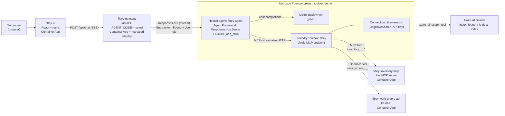
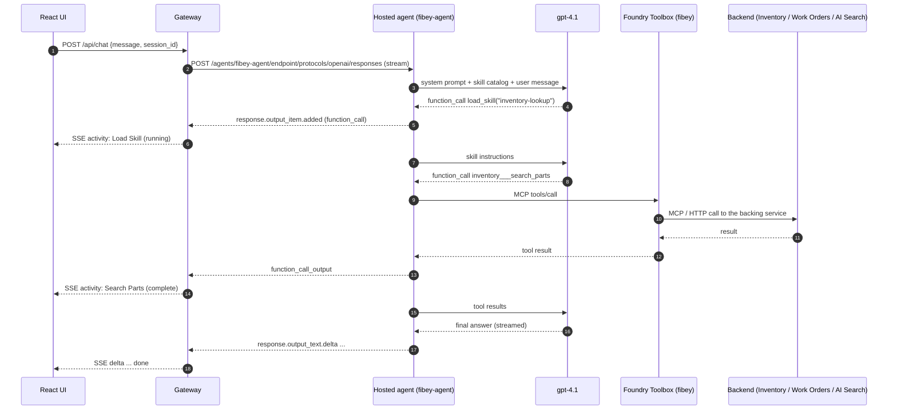

# Fibey Field Ops

Fibey is a runnable demo of a **Microsoft Foundry hosted agent** that helps
fiber-optic field technicians. The agent reaches three different backend
systems — an inventory MCP server, a work-orders REST API, and a knowledge
base in Azure AI Search — through **one** endpoint: the **Foundry Toolbox**.

> Based on [microsoft-foundry/build-2026-demos › toolbox-fibey-demo](https://github.com/microsoft-foundry/build-2026-demos/tree/main/agent-tools-and-integrations/toolbox-fibey-demo),
> with fixes needed to deploy and run it end to end (see [Changes from the upstream sample](#changes-from-the-upstream-sample)).

## What the agent can do

- Look up fiber parts, SKUs, stock levels, and warehouse locations
- View, create, and update work orders
- Retrieve splicing procedures, safety protocols, specs, and troubleshooting guidance
- Combine all of the above into a field briefing for a job

## Deployed architecture (hosted agent)



### Request flow (one chat turn)



1. The **UI** sends the message to the **gateway** and renders the streamed
   answer plus the **Activity** sidebar (one entry per skill/tool call).
2. The **gateway** authenticates to Foundry with its managed identity and
   proxies to the hosted agent's Responses endpoint, translating Responses
   stream events (`function_call`, `function_call_output`, `output_text.delta`)
   into the UI's SSE events (`activity`, `delta`, `done`).
3. The **hosted agent** (`src/fibey/agent/hosted.py`) runs Microsoft Agent
   Framework inside Foundry. It loads the system prompt and the skills, calls
   `gpt-4.1`, and executes tool calls against the Toolbox MCP endpoint.
4. The **Toolbox** exposes every backend as MCP tools behind one URL and one
   auth boundary, and dispatches each call to the right backend.

## Tools and data behind the Toolbox

| Toolbox tool | Type | Backend | Tools exposed to the agent |
|---|---|---|---|
| `inventory` | MCP (streamable HTTP) | `services/inventory-mcp` on Container Apps | `inventory___search_parts`, `inventory___list_parts`, `inventory___get_part_details`, `inventory___check_stock`, `inventory___check_stock_batch` |
| `work_orders` | OpenAPI | `services/work-orders-api` on Container Apps | `work_orders___list_work_orders_*`, `work_orders___get_work_order_*`, `work_orders___create_work_order_*`, `work_orders___update_work_order_*`, `work_orders___health_check_*` |
| `azure_ai_search` | Azure AI Search | Index `foundry-iq-docs-index` via connection `fibey-search` | `azure_ai_search` (semantic search over the knowledge base) |

### Inventory MCP — `services/inventory-mcp/data/inventory.json`

28 fiber-optic parts (IDs `FIB-001`…), each with `id`, `name`, `description`,
`category`, `sku`, `unit_price`, `stock_quantity`, `min_stock_threshold`,
`location` (warehouse bin), and `manufacturer`. Stock status is computed as
**in-stock / low / out-of-stock** from quantity vs. threshold.

| Category | Parts | Examples |
|---|---|---|
| Connectors | 4 | SC/APC fast connector, LC/UPC duplex connector, LC/APC connector kit |
| Cables | 4 | Singlemode patch cables (2m, 5m), OM4 patch cable, outdoor drop cable 500m reel |
| Splice Equipment | 5 | Core alignment fusion splicer, 24-core splice tray, heat shrink protectors, mechanical splice kit |
| Test Equipment | 4 | Handheld OTDR 1310/1550nm, optical power meter kit, visual fault locator, inspection probe |
| Network Equipment | 5 | GPON / XGS-PON OLTs and ONTs, 24-port rack-mount patch panel |
| Splitters | 3 | PLC splitters 1x8, 1x16, 1x32 (SC/APC) |
| Tools | 3 | 3-hole fiber stripper, precision cleaver, Kevlar scissors |

### Work Orders API — `services/work-orders-api/data/work_orders.json`

12 work orders (`WO-001`…`WO-012`) with `id`, `title`, `description`,
`status`, `priority`, `assigned_technician`, `location`, `parts_needed`
(part IDs + quantities, linking to inventory), `created_at`, `updated_at`,
and `due_date`. Endpoints: `GET /work-orders` (filter by status, priority,
technician), `GET /work-orders/{id}`, `POST /work-orders`,
`PATCH /work-orders/{id}`, `GET /health`. Data is in memory, so creates and
updates reset when the container restarts.

| Status | Count | | Priority | Count |
|---|---|---|---|---|
| open | 5 | | critical | 3 |
| in_progress | 4 | | high | 4 |
| completed | 2 | | medium | 3 |
| cancelled | 1 | | low | 2 |

### Knowledge base (FoundryIQ content) — `services/foundry-iq-docs/docs/`

Eight internal field-operations reference documents, indexed into Azure AI
Search index **`foundry-iq-docs-index`** (fields `id`, `metadata_storage_name`,
`content`; semantic configuration `default`). Each document is split on its
`## ` headings into **123 section chunks** so search results stay small enough
for the model's context.

| Document | What it covers |
|---|---|
| `fiber-splicing-procedures.md` | Acceptance criteria, preparation, cleaving, fusion and mechanical splicing, splice protection and tray management, QA |
| `safety-protocols.md` | Minimum PPE by task, laser safety, working at heights, trench/handhole, chemical and electrical safety, emergency response |
| `troubleshooting-guide.md` | Decision tree, high splice loss, dirty connectors, macrobends, fiber breaks, symptom-to-cause matrix |
| `otdr-testing-guide.md` | Pre-test planning, setup and calibration, test procedure, interpreting traces, loss budgets, dead zones |
| `cable-types-reference.md` | Single-mode and multimode reference, cable constructions, indoor/outdoor, armored, aerial, buried, ribbon |
| `equipment-specifications.md` | Fusion splicers, OTDRs, power meters, VFLs, cleavers, inspection probes, calibration schedule |
| `installation-standards.md` | Bend radius, pulling tension, splice closures, routing and tray standards, labeling, acceptance checklist |
| `network-architecture.md` | PON topology, OLT/ONT, splitter architecture, GPON and XGS-PON, power budgets, fault isolation |

### Status dashboard — `services/status-dashboard`

A static HTML network/service status page. It is deployed as a Container App
(`fibey-status-dashboard`) but is **not** registered in the Toolbox in this
deployment (the upstream sample uses browser automation for it).

## Skills — how the agent decides what to do

Skills are markdown playbooks in [`src/fibey/agent/skills/`](src/fibey/agent/skills).
The Agent Framework `SkillsProvider` gives the model a short catalog of skill
names and descriptions plus a `load_skill` tool. When a request matches a
skill, the model calls `load_skill("<name>")` to pull in the full
instructions on demand (progressive disclosure), then follows them: which
Toolbox tools to call, in what order, and how to format the answer (tables,
status icons, safety callouts).

| Skill | Used when the technician… | What it tells the agent to do |
|---|---|---|
| `inventory-lookup` | asks about parts, stock, SKUs, equipment availability | Search/list parts, check stock (batch for multiple parts), show stock status and warehouse location |
| `knowledge-retrieval` | asks how-to, safety, specs, OTDR, splicing, or troubleshooting questions | Map the question to a knowledge-base query, answer from the retrieved content, and format with tables and collapsible detail sections |
| `work-order-management` | wants to view, list, create, or update work orders | Pick the right work-orders operation, always filter when listing, ask for missing fields before creating, format with status/priority labels |
| `work-order-preparation` | asks "what do I need for WO-XXX?" | Fetch the work order, check stock for every part in `parts_needed`, present a preparation checklist with a summary and next steps |
| `field-briefing` | wants a full briefing for a job | Fetch the work order, check parts availability, then make one combined knowledge-base search for the relevant procedure and safety protocols |

The Toolbox can also publish skills over MCP (`resources/list`); the hosted
agent uses those first and falls back to the bundled skill files when the
Toolbox publishes none (as in this deployment).

## Test results (deployed, through the UI)

| Prompt | Tools the agent called (Activity sidebar) | Result |
|---|---|---|
| Check stock for splice trays | Load Skill (`inventory-lookup`) → Knowledge Base → Search Parts → Check Stock (Batch) | Splice trays listed with stock status, quantity, and warehouse location |
| What PPE do I need for fusion splicing? | Load Skill (`knowledge-retrieval`) → Knowledge Base | Safety glasses, fiber-safe gloves, shard bottle — from `safety-protocols.md` |
| List open high priority work orders | Load Skill (`work-order-management`) → Knowledge Base → List Work Orders | Table of open high/critical work orders with technician, location, and due date |

> Tip: start a new chat for each demo prompt. The hosted agent runs with
> `store: False`, so it does not keep conversation history between turns.

## Deployed resources (this repo's demo environment)

| Resource | Name | Notes |
|---|---|---|
| Foundry account / project | `toolbox-demo-smasina` / `toolbox-demo` (rg `rg-toolbox-demo`, Sweden Central) | Hosts the agent, model, toolbox, and connection |
| Hosted agent | `fibey-agent` (version 1) | Image `acrfibey36442.azurecr.io/fibey-hosted-agent:v1`, env `AZURE_AI_MODEL_DEPLOYMENT_NAME=gpt-4.1`, `TOOLBOX_NAME=fibey` |
| Model deployment | `gpt-4.1` (GlobalStandard) | Used by the agent |
| Foundry Toolbox | `fibey` (version 1) | Tools: `inventory` (MCP), `work_orders` (OpenAPI), `azure_ai_search` |
| Project connection | `fibey-search` | CognitiveSearch, API key, used by the `azure_ai_search` tool |
| Resource group | `rg-fibey-demo` (Sweden Central) | Container Apps environment `fibey-cae`, registry `acrfibey36442` |
| Container Apps | `fibey-ui`, `fibey-gateway`, `fibey-inventory-mcp`, `fibey-work-orders-api`, `fibey-status-dashboard`, `fibey-agent-service` | `fibey-agent-service` is the self-hosted fallback agent |
| Azure AI Search | `fibey-search-sm-northeurope` (Basic, North Europe) | Sweden Central had no Search capacity |

**Fallback:** the gateway can switch from the Foundry hosted agent to the
self-hosted agent service without redeploying:

```powershell
az containerapp update -g rg-fibey-demo -n fibey-gateway --set-env-vars AGENT_MODE=containerapp   # self-hosted
az containerapp update -g rg-fibey-demo -n fibey-gateway --set-env-vars AGENT_MODE=hosted         # Foundry hosted agent
```

## Changes from the upstream sample

- **Hosted agent image** (`Dockerfile.agent`) and **agent service image**
  (`Dockerfile.agent-service`) install dependencies from `uv.lock`. Unpinned
  `agent-framework` releases stop the tool-calling loop after the first call.
- **Inventory MCP** pins `mcp<2` and builds from its lockfile; `mcp` 2.x
  removed `FastMCP` and the server crashed on startup.
- **`hosted.py`** falls back to the bundled skill files when the Toolbox
  publishes no skills.
- **`agent.py`** fixed an `UnboundLocalError` (`_json`) in the streaming loop.
- **Gateway hosted mode** keeps the tool name and arguments on completion
  events so the Activity sidebar shows each step; the UI labels
  `azure_ai_search` as **Knowledge Base**.
- **Model:** `gpt-4.1`. `gpt-5.4` stopped after the first tool call with this
  Agent Framework version, and `gpt-4.1-mini` hit rate limits in Sweden Central.
- **Knowledge base:** documents are pushed directly into the search index as
  section chunks rather than whole files.

## Architecture (local mode)

```text
┌──────────────┐  /api/chat  ┌──────────────────┐  in-proc  ┌──────────────────┐
│  React UI    │ ──────────► │  FastAPI Gateway │ ────────► │  Fibey Agent     │
│  + Activity  │ ◄── SSE ─── │  (:8080)         │           │  (agent-fw)      │
└──────────────┘             └──────────────────┘           └────────┬─────────┘
                                                                     │
                                                         Foundry Toolbox MCP
                                                                     │
              ┌────────────────┬───────────────────┬─────────────────┐
              │ inventory-mcp  │ work-orders-api   │ FoundryIQ KB    │
              │   (:8001)      │    (:8002)        │ (AI Search)     │
              └────────────────┴───────────────────┴─────────────────┘
```

The sample also ships **containerapp** and **hosted** modes — see
[docs/architecture.md](docs/architecture.md).

## Prerequisites

- Python 3.12+
- Node.js 20+
- [uv](https://docs.astral.sh/uv/) (Python package manager)
- Azure CLI (`az`) + Azure Developer CLI (`azd`) — only needed for cloud deploy
- An Azure AI Foundry project with a deployed model and a configured Toolbox

## Quickstart (local)

```bash
# 1) Install Python and UI dependencies
./scripts/setup.sh

# 2) Copy and edit environment variables
cp .env.example .env
# At minimum set FOUNDRY_PROJECT_ENDPOINT, FOUNDRY_MODEL, TOOLBOX_MCP_URL

# 3) Start the gateway + UI
./scripts/start-dev.sh

# 4) (optional) In separate terminals, start the local toolbox backends
cd services/inventory-mcp     && uv sync && uv run python server.py
cd services/work-orders-api   && uv sync && uv run python server.py
cd services/status-dashboard/public && python -m http.server 8003
```

Open the UI at <http://localhost:5173>.

| Service | Local URL |
|---|---|
| UI | `http://localhost:5173` |
| Gateway | `http://localhost:8080` |
| Inventory MCP | `http://localhost:8001` |
| Work Orders API | `http://localhost:8002` |
| Status Dashboard | `http://localhost:8003` |

> **Toolbox URL gotcha:** `TOOLBOX_MCP_URL` should **not** include
> `?api-version=v1`. The agent code auto-appends it. The Toolbox MCP
> endpoint requires `api-version=v1` (not a date-based version).

## Deploy to Azure

The full stack (UI, gateway, agent service, work-orders API, inventory MCP,
AI Search, blob storage) deploys to Azure Container Apps via `azd`:

```bash
az login
azd auth login
azd up
```

See [docs/deployment.md](docs/deployment.md) for the full deployment guide,
including FoundryIQ knowledge base setup and post-deploy RBAC.

## Documentation

| Doc | When to read it |
|---|---|
| [`docs/toolbox-integration.md`](docs/toolbox-integration.md) | The integration recipe (custom `httpx.Auth`, headers, MCP gotchas) |
| [`docs/architecture.md`](docs/architecture.md) | Full system diagram, components, streaming protocol, agent modes |
| [`docs/local-development.md`](docs/local-development.md) | All env vars, running individual services, testing the gateway API |
| [`docs/deployment.md`](docs/deployment.md) | Azure deployment via `azd`, knowledge base setup, RBAC |
| [`docs/session-overview.md`](docs/session-overview.md) | High-level narrative for the BRK242 reference copy |
| [`infra-agent/README.md`](infra-agent/README.md) | Foundry-hosted agent infrastructure notes |

## Project layout

```text
src/fibey/                # Python package: agent + gateway
services/
  inventory-mcp/          # MCP inventory server (port 8001)
  work-orders-api/        # FastAPI work-orders service (port 8002)
  status-dashboard/       # Static service-status dashboard (port 8003)
  foundry-iq-docs/        # Markdown source for the FoundryIQ knowledge base
ui/                       # React + TypeScript + Tailwind frontend
infra/                    # Bicep modules for Container Apps + AI Search + blob
infra-agent/              # Foundry-hosted agent infra notes
scripts/                  # setup.sh, start-dev.sh, setup-knowledge-base.sh
docs/                     # Architecture, deployment, local-dev, integration docs
```

## License

Licensed under the MIT License — see [LICENSE](LICENSE).
